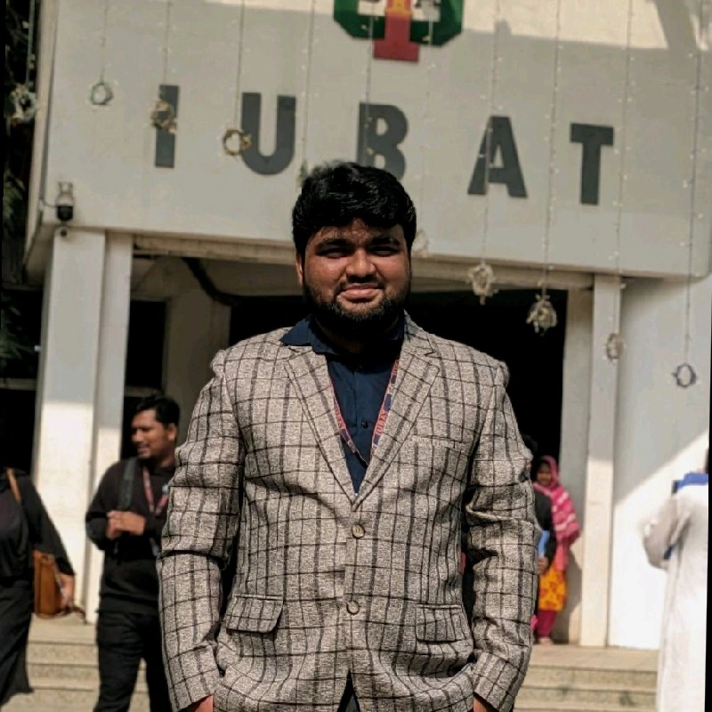

 

 

# Md Mokhlesur Rahman Momin

### MERN Stack Developer · Aspiring SQA Engineer

*Building for the web. Learning to make it reliable.*

---

01 / ABOUT

## I build. I test. I improve.

I'm **Md Mokhlesur Rahman Momin**, a MERN Stack Developer and Aspiring Software Quality Assurance Engineer. I enjoy building web applications, solving technical problems, working with databases, and understanding how software behaves under different conditions.

I'm developing my full-stack development skills while building a stronger foundation in software testing, defect identification, and application reliability.

<table>
<tr>
<td width="50%" valign="top">

### Web Development

- React-based user interfaces
- Node.js and Express APIs
- MongoDB integration
- Debugging and problem-solving

</td>
<td width="50%" valign="top">

### Software Quality Assurance

- Manual testing fundamentals
- Test scenario and test case design
- Defect identification and reporting
- API testing and automation practice

</td>
</tr>
</table>
</td>
</td>
</td>

MY PRINCIPLE

**Build with purpose. Test with care. Improve continuously.**

---

02 / TOOLKIT

## Technologies I work with

  

| Area | Technologies and focus |
|---|---|
| MERN Development | JavaScript, React, Node.js, Express.js, MongoDB |
| Web Fundamentals | HTML5, CSS3 |
| Software QA | Manual testing, test scenarios, test cases, defect reporting |
| API Testing | Currently practising |
| Additional Technologies | ASP.NET MVC, C#, PHP, MySQL |
| Development Tools | Git, GitHub, VS Code |

03 / PROJECTS

## Projects built through practice

*Different projects. Different challenges. Continuous learning.*

<!-- AUTO-PROJECTS:START -->
<!-- AUTO-PROJECTS:END -->

---

04 / QUALITY MINDSET

## Better software starts with better testing

Writing code is one part of development. Understanding how it can fail is another.

<table width="100%">
<tr>
<td width="25%" align="center" valign="top">

**01**

### Understand

Requirements and expected behaviour

</td>
<td width="25%" align="center" valign="top">

**02**

### Design

Test scenarios and test cases

</td>
<td width="25%" align="center" valign="top">

**03**

### Investigate

Reproduce and report defects

</td>
<td width="25%" align="center" valign="top">

**04**

### Improve

Learn testing and automation

</td>
</tr>
</table>

---

05 / GITHUB ACTIVITY

## My development activity

A snapshot of my public GitHub repositories and activity.

  

### Contribution Snake

Generated from my GitHub contribution graph.

---

06 / CURRENT FOCUS

## What I'm working towards

<table width="100%">
<tr>
<td align="center" width="25%" valign="top">

<h3>01</h3>

**BUILD**

Full-stack web applications

</td>
<td align="center" width="25%" valign="top">

<h3>02</h3>

**TEST**

Manual and API testing

</td>
<td align="center" width="25%" valign="top">

<h3>03</h3>

**DEBUG**

Identify and investigate defects

</td>
<td align="center" width="25%" valign="top">

<h3>04</h3>

**IMPROVE**

Reliable software development

</td>
</tr>
</table>

---

07 / LET'S CONNECT

## Let's build something useful.

Interested in web development, software testing, and practical technology projects.

 

  

<a href="https://github.com/momin078">GitHub</a> ·
<a href="https://www.linkedin.com/in/md-mokhlesur-rahman-momin-90394a291/">LinkedIn</a>

  

BUILD WITH PURPOSE. TEST WITH CARE. KEEP IMPROVING.

